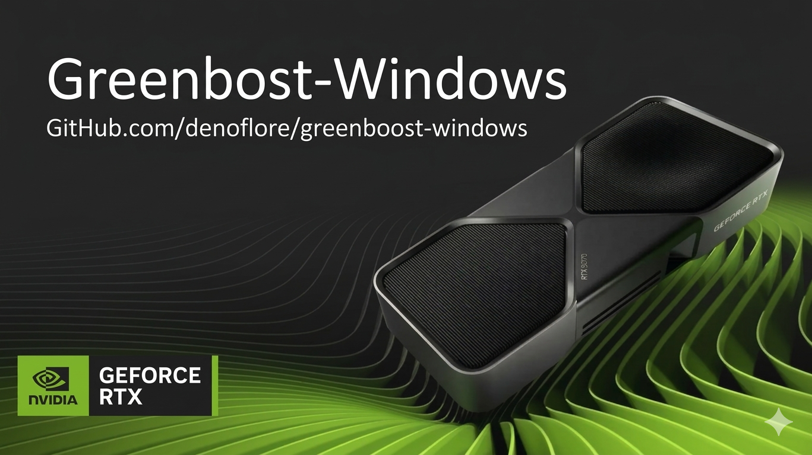

# GreenBoost for Windows

[](https://github.com/denoflore/greenboost-windows/actions/workflows/windows-build.yml)

One CUDA address space, with explicit choices about where the bytes live.
GreenBoost provides a portable launcher and allocation shim for NVIDIA CUDA
applications. The current source adds native VRAM allocation first, quantized KV cache
controls, GPU capability inspection and a developer library for keeping file
regions at stable CUDA addresses with bounded VRAM residency.

**Main contains 2.5.0 experimental.** Build it from source using the commands
below. The latest published binary package remains
[2.4.0 beta 3](https://github.com/denoflore/greenboost-windows/releases/tag/v2.4.0-beta.3),
which uses the previous allocation policy and does not include the file residency
API. No GreenBoost kernel driver, administrator access or Windows test-signing
mode is required.

[Design and results](windows-port/EXPERIMENTAL.md) |
[Build](windows-port/BUILDING.md) |
[RTX backend](windows-port/RTX_KERNELS.md) |
[Troubleshooting](windows-port/TROUBLESHOOTING.md)

## Build and run

Build with Visual Studio C++, CMake and Microsoft Detours 4.0.1:

```powershell
.\windows-port\build.ps1 -DetoursRoot C:\deps\Detours -StaticRuntime -Package
```

Extract `windows-port/tools/outputs/GreenBoost-Windows-2.5.0-experimental-x64.zip`.
Keep `greenboost.exe` and `greenboost_cuda.dll` together. From that folder:

```powershell
.\greenboost-info.exe
.\install_llama.ps1 -Cuda 13.4
.\run_llama.ps1 -ListDevices
.\run_llama.ps1 -Model 'D:\models\model.gguf' -Gpu 0 -CacheType q8_0
```

The optional installer supplies official **llama.cpp b12019**, including its
October feed-forward fusion, CUDA graph and Flash Attention updates. The launch
profile selects one CUDA GPU, puts model tensors on that GPU and uses supported
GPU sampling. Existing applications keep their own backends. Use the CUDA
ordinal printed by the tool; it can differ from `nvidia-smi`.

For the same backend with CUDA 12.4, including RTX 2000 code:

```powershell
.\install_llama.ps1 -Cuda 12.4
.\run_llama.ps1 -Cuda 12.4 -Model 'D:\models\model.gguf' -Gpu 0
```

The CUDA 13.4 backend includes RTX 3000, 4000 and 5000 kernels. RTX 2000 execution
has not been tested locally. Older-runtime compatibility does not establish
compatibility with every older driver. AMD and Intel are outside this CUDA port.

Launch another x64 CUDA application with `greenboost.exe application.exe arguments`.
The launcher starts a fresh process, propagates injection through x64
`CreateProcessA/W` children, waits and returns the application's exit code.
An existing background server is unaffected. Windows 10/11 x64 and a compatible
NVIDIA driver are required; applications retain their own runtime dependencies.

## Memory and compression controls

The default **adaptive** allocator asks CUDA for native device memory first.
An eligible allocation tries managed memory only after native out-of-memory.
`GREENBOOST_ALLOC_POLICY=managed` selects the previous policy explicitly.

| Setting | Default | Effect |
| --- | --- | --- |
| `GREENBOOST_ALLOC_POLICY` | `adaptive` | Native VRAM first; `managed` tries managed memory first. |
| `GREENBOOST_EXTRA_MB` | Half of available RAM, limited by reserve | Additional reported capacity allowance; `0` disables extension. |
| `GREENBOOST_RESERVE_MB` | `8192` | RAM excluded from the allowance. |
| `GREENBOOST_THRESHOLD_MB` | `256` | Minimum allocation size eligible for the managed path. |
| `GREENBOOST_DEBUG` | `0` | `1` prints allocation decisions and child PIDs. |
| `GREENBOOST_LEGACY_DRIVER` | `0` | `1` enables the separately installed, unqualified KMDF path. |

Sizes are MiB. The allowance is planning information, not reserved memory
or an oversubscription guarantee. Windows managed memory has important
[platform limits](https://docs.nvidia.com/cuda/cuda-programming-guide/04-special-topics/unified-memory.html).
NVML and `nvidia-smi` continue to show physical VRAM.

`run_llama.ps1` accepts `-AllocationPolicy`, `-CacheType f16|q8_0|q4_0`,
`-Context`, `-Batch`, `-MicroBatch`, `-Mode Benchmark` and `-VerboseBackend`.
The default cache remains f16. Quantized caches reduce memory and can change
model output. The helper restores its environment settings on exit.

## Tested compatibility

The October 31, 2026 checks passed all five allocation cases across CUDA 11.8,
12.0, 12.4, 12.9, 13.0, 13.1, 13.3 and 13.4 on an RTX 3060 with NVIDIA 610.88.
The extracted package passed the same five CUDA 13.4 cases on an RTX 5090,
for 45 runtime cases in total. Both allocation policies and the file residency
test also passed on RTX 3060, 3090, 4090, 5060 Ti and 5090.

These are recorded workstation results. GitHub Actions checks the portable
build and package without a GPU. RTX 2000 hardware, older drivers and long
production runs remain unverified. See the
[test conditions and receipts](windows-port/EXPERIMENTAL.md).

## What was measured

On Windows 11 with NVIDIA 610.88, a Qwen3.5 4B Q6_K model on the RTX 3060 decoded
at **1.39 to 1.44 tokens/s with beta 3's managed policy and 68.67 to 69.03 with
adaptive allocation**, with all five local GPUs visible. This short comparison
used 128 prompt tokens, 8 generated tokens and two repetitions per run.
With only one GPU visible, 3060/4090/5090 performance was broadly similar
between policies. This is a measured recovery from that configuration's slow
path, not a universal speed multiplier.

At a 32,768 token context, the same model's CUDA KV buffer measured **1,024 MiB
for f16, 544 MiB for q8_0 and 288 MiB for q4_0**. Each completed the same short
code-repetition prompt with GPU sampling. Broader quality and long-context
accuracy remain unmeasured.

See [EXPERIMENTAL.md](windows-port/EXPERIMENTAL.md) for process, device,
utilisation, test conditions and limits. Earlier release measurements remain
in [VALIDATION.md](windows-port/VALIDATION.md) and
[COMPATIBILITY.md](windows-port/COMPATIBILITY.md), labelled by release.

## File capacity in one CUDA address range

The optional `greenboost::FileTensor` library reserves a CUDA address range for
a read-only file, stages Windows reads through pinned RAM and reuses a bounded
pool of VRAM mappings. A region keeps its virtual address after eviction and
reload. CUDA performs tensor computation.

The developer calls `acquire(offset, bytes)` before scheduling a kernel on the
library's stream. It is **not integrated with llama.cpp's tensor scheduler**
and cannot transparently page arbitrary CUDA kernels. No NVMe capacity is
advertised as VRAM. File I/O currently uses Windows caching.

Build with `-Storage -CudaRoot 'C:\Program Files\NVIDIA GPU Computing Toolkit\CUDA\v13.3'`
to include the library, header and GPU test in a separate storage ZIP.
See [API usage and measurements](windows-port/EXPERIMENTAL.md).

## Check an installation

```powershell
# Adaptive allocation should stay native when 512 MiB fits.
.\test_cuda.exe .\greenboost_cuda.dll 2 0 512 0
.\test_compatibility.ps1 -RuntimePath 'C:\my-app\cudart64_13.dll' -Device 0
```

The runtime test uses five fresh processes: native, adaptive, managed,
below-threshold and extension-disabled. Each performs a GPU write, scalar
readback and free. Use the actual runtime supplied by your application.
Explicit managed allocations, asynchronous pools and CUDA VMM retain NVIDIA's
implementation; the allocation shim does not extend those APIs.

Original GreenBoost by [Ferran Duarri](https://gitlab.com/IsolatedOctopi/greenboost).
Windows port and maintenance by [Chris Zuger / denoflore](https://github.com/denoflore).
Linux sources are retained from upstream and are outside this experiment.
[GPL v2](LICENSE); Microsoft Detours is MIT licensed.
